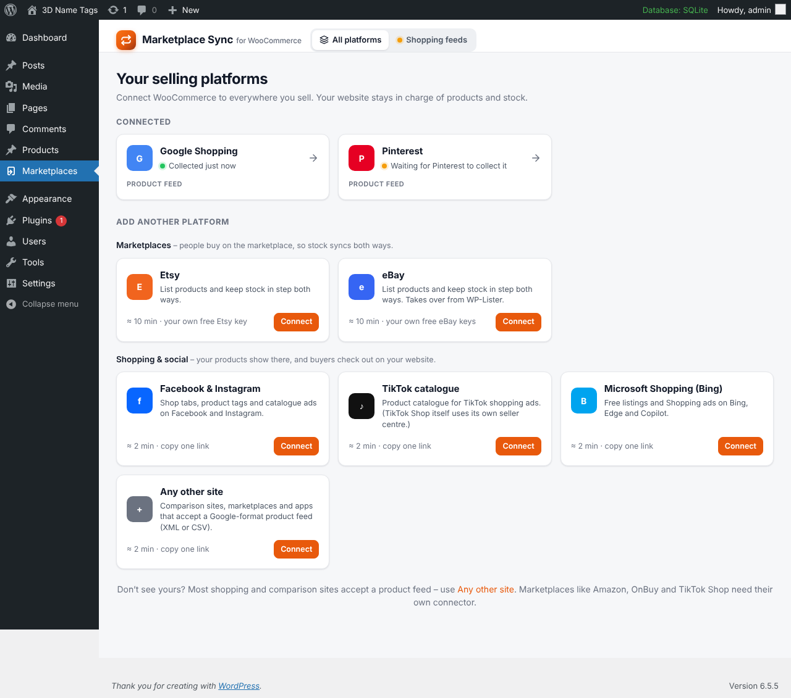
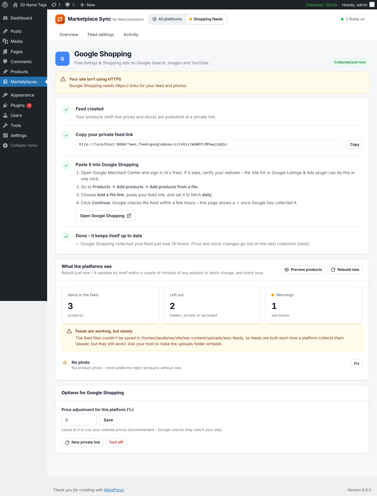

# Marketplace Sync for WooCommerce

Sell everywhere from one WooCommerce shop. Your website stays in charge of products, prices and stock.

| Platform | How it connects | Stock |
|---|---|---|
| **Etsy** | Your own free Etsy API key | Two-way sync (website ⇄ Etsy) |
| **eBay** (13 countries) | Your own free eBay developer keys | Two-way sync (website ⇄ eBay) |
| **Google Shopping** | Paste one private feed link | Always current (buyers check out on your site) |
| **Facebook & Instagram Shop** | Paste one private feed link | Always current |
| **Pinterest** | Paste one private feed link | Always current |
| **TikTok catalogue** | Paste one private feed link | Always current |
| **Microsoft Shopping (Bing)** | Paste one private feed link | Always current |
| **Any other feed-based site** | XML or CSV feed link | Always current |

No middleman servers: the plugin talks straight to each platform with your own keys, so it keeps working even if this project goes quiet.

## Install

1. Go to **[Releases](../../releases/latest)** and download **`woo-etsy-sync.zip`**.
   (Don't use the green *Code → Download ZIP* button: that one has the wrong folder name and installs a second copy.)
2. In WordPress: **Plugins → Add New → Upload Plugin**, choose the zip, **Install Now**, then **Activate**.
   Already have it? Upload anyway and pick **Replace current with uploaded**. Settings and product links are kept.
3. Open **Marketplaces** in the WordPress menu and click **Connect** on any platform. Each one has step-by-step instructions.

### Requirements

- WordPress 6.2 or newer, WooCommerce 7.0 or newer, PHP 7.4 or newer (tested up to PHP 8.4)
- HTTPS (Etsy, eBay and the shopping sites all require it)
- Works with single sites and multisite, any currency, any country, pretty or plain permalinks, and sites in a sub-folder

## Updates

Sites installed from a release zip update themselves from this repository. When a new release is published, WordPress shows the normal **Update available** button within a few hours. **Plugins → Marketplace Sync → Check for updates** checks straight away.

## Publishing a new version (for the repo owner)

1. Commit your changes.
2. On GitHub: **Releases → Draft a new release → Choose a tag**, type the new version number (e.g. `1.3.1`), then **Publish release**.
3. The *Release* workflow builds `woo-etsy-sync.zip` and attaches it to the release. It sets the version number inside the plugin from the tag, so you don't need to edit any files.

To build a zip on your own computer, run `bin/build-zip.sh 1.3.1 your-name/your-repo`. The zip is saved in `build/`.

## Translating

Every screen and message is translatable. The template is [`languages/woo-etsy-sync.pot`](languages/woo-etsy-sync.pot).

The easiest way to translate is the free [Loco Translate](https://wordpress.org/plugins/loco-translate/) plugin, which also creates the JSON files the app screens use. To regenerate the template after changing text, run `wp i18n make-pot . languages/woo-etsy-sync.pot --exclude=build,bin,.github,docs`.

## Shopping & social feeds

- Each colour or size goes out as its own item, with its own price, photo and stock, grouped under the parent product.
- The feed is rebuilt a couple of minutes after any product or stock change, and every hour.
- Descriptions have links and formatting removed. Products without barcodes are sent as "no identifier", which is correct for handmade items.
- Prices include tax, except for US and Canadian shops, where shopping sites expect prices before tax.
- Options: Google product category per WooCommerce category, leave out categories or single products, and a price adjustment per platform.
- If *Google Listings & Ads*, *Facebook for WooCommerce*, *Pinterest for WooCommerce* or *TikTok for WooCommerce* is active, you get a warning so products aren't sent twice.

## For developers

- No build step: plain PHP and vanilla JavaScript (`assets/`), using WordPress's own `wp.apiFetch` and `wp.i18n`.
- Background work runs on WooCommerce's Action Scheduler (group `woo-etsy-sync`).
- REST namespace: `woo-etsy-sync/v1` (needs the `manage_woocommerce` capability).
- **Filters:** `wes_feed_price_function`, `wes_ebay_title`, `wes_ebay_description`, `wes_ebay_price`, `wes_ebay_quantity`, `wes_ebay_specifics`, `wes_ebay_item`, `wes_listing_title`, `wes_listing_description`, `wes_listing_tags`, `wes_listing_price`, `wes_listing_quantity`, `wes_listing_fields`, `wes_listing_image_ids`
- **Actions:** `wes_product_synced`, `wes_etsy_sale_applied`, `wes_settings_updated`
- **Updates from a different repository:** add `define( 'WES_GITHUB_REPO', 'owner/repo' );` to `wp-config.php`.
- Every push runs the *Checks* workflow: PHP syntax on 7.4 to 8.4, JavaScript syntax, and a test zip build.

The plugin folder and text domain are still `woo-etsy-sync` (its original name), so existing installs update in place.

## Licence

GPL-2.0-or-later. See [LICENSE](LICENSE).
